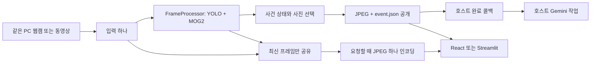

# 모션 모듈 구조와 연결 계약

2026-10-12 리팩터링 구현 기준. 이 모듈은 고정 카메라/동영상의 객체 모션 감지부터 사건 사진 저장까지 담당한다.
Gemini 분석, 업무 조건 판단, 알림, DB와 장기 이력은 사용하는 프로젝트가 담당한다.

## 구조

```text
motion_person/
  domain/          데이터·설정 값 검증·좌표 계산·모션 판정·사진 선택
  application/     공통 분석·사건 상태·실행과 자원 정리·작은 Protocol
  adapters/        YOLO·MOG2·웹캠/파일·JPEG·파일 저장·선택 진단/미리보기
  presentation/    CLI·OpenCV 화면·기존 개별 캡처 진입점
  composition.py   기본 구현 선택과 초기화
examples/
  fastapi/         카메라 실행 소유·조회 API·선택 외부 분석 대기열
  react/           MJPEG 화면과 사건별 사진 묶음
  streamlit/       같은 FastAPI의 JPEG/사진 조회
```

기존 `motion_person/engine.py`, `object_detector.py` 등과 저장소 루트의 진입점은 호환 위임이다.
실제 구현은 위 폴더에만 있다. `MotionEngine`, `EventConfig`, `EventBundle`의 공개 import는 유지했다.

domain은 OpenCV·Ultralytics·FastAPI·파일 쓰기를 import하지 않는다. `FrameProcessor`는 탐지기의
`detect(frame)` 계약만 사용한다. YOLO 준비는 기본 조립에서 선택하며, 자체 탐지기는 필요할 때
`prepare_detector` 함수로 초기화한다. `EventCaptureEngine`은 `BundleStore.publish()`와 JPEG 함수를 주입받는다.
`MotionEngine`은 간단한 공개 사용법을 위한 실행 facade여서 입력 생성·선택 화면·진단을 조립한다.
의미 없는 CRUD repository, 이벤트 버스나 DB 계층은 추가하지 않았다.

파일·웹캠·저장 없는 미리보기·기존 CLI가 같은 `FrameProcessor`의 분석 순서를 사용한다.
기존 CLI의 개별 사진 저장 정책은 사건 묶음 정책과 다르므로 `legacy/`에 남겼다.
기존 이력용 `ObjectStateStore`는 새 사건 엔진에서 생성하지 않는다.

## 한 카메라의 흐름



웹캠 읽기 스레드는 최신 프레임 하나를 교체한다. 분석은 선택된 프레임을 한 번 소비하고,
미리보기는 `snapshot()`으로 빌려 읽으므로 분석할 프레임을 빼앗지 않는다. 파일의 `snapshot()`도
디코딩을 진행하지 않는다. 느린 화면은 중간 프레임을 건너뛰며 카메라·모델을 추가 생성하지 않는다.
박스 미리보기는 최근 분석의 이미지와 좌표를 함께 표시한다.

`start()`는 블로킹이며 호스트가 실행 스레드를 소유한다. 모델 준비 뒤 입력을 열고, 종료·오류·인터럽트에서
관측한 꼬리 구간을 처리하고 자원을 닫는다. 동일 인스턴스의 동시 실행은 거부한다. 실행 간에는 모델과
추적 상태를 새로 준비한다. FastAPI 예제는 중복 시작 요청을 같은 실행으로 돌려주며 다른 설정은 409로 거부한다.
Uvicorn worker는 1개로 실행한다. 프로세스별 메모리를 공유하는 분산 카메라 관리 기능은 없다.

미리보기·진단 실패는 핵심 사진 저장과 완료 콜백을 막지 않는다. 사진 인코딩/저장 실패와 소비자 콜백
실패는 실행 오류다. 후속 사진 인코딩 실패·인터럽트 전 이미 공개된 묶음은 완료 큐에서 회수해 전달한다.
정리 도중 오류가 추가되어도 최초 핵심 오류를 유지한다. 종료 상태에는 flush된 묶음 수와 비활성 상태를 반영한다.

## 사건과 사진 품질

| 정보 | 의미 |
| --- | --- |
| `event_id` | 가까운 시간의 모션 에피소드. 추적 번호 변경만으로 분리하지 않음 |
| `part_index` | 최대 10초 사진 묶음의 순서. 사전·진행·사후 시간을 합한 제한 |
| `episode_end` | 모션 수집 에피소드가 닫힘. 업무 조건 해제나 실제 행동 종료의 확정은 아님 |
| `phase` / `roles` | 시간순 사진의 이전·시작·진행·이후와 선택 근거 |
| `pre_context_complete` / `post_context_complete` | 요청한 구간의 관측 범위와 누락 여부 |
| `context_complete` | 관측 범위·누락·메모리 제거를 종합. 최종 사진의 모든 맥락 포함 보장은 아님 |
| `evidence_complete` | 움직임 증거 사진이 있고, 확인된 움직임 객체 키의 누락이 없음 |
| `omitted_moving_objects` | 사진/메모리 예산 때문에 증거를 남기지 못한 객체 키 |

최대 6장 선택에서 움직임 증거를 보존하고 남는 예산을 시간 맥락에 사용한다. 2장 설정은 첫 움직임 사진과
마지막 사진을 우선한다. 순간 사건/중복 시각은 1장일 수도 있다. 사진은 원본 전체 프레임이며 ROI·화면 반전·
화면 박스·미리보기 압축과 독립적이다. 파일 공개는 임시 폴더에 JPEG와 manifest를 쓴 후 rename한다.
외부 콜백은 공개가 끝난 후 호출한다. 이 방식은 정상 프로세스 실행에서 부분 묶음 노출을 줄이며,
정전 이후 디렉터리의 내구성까지 보장하는 트랜잭션 시스템은 아니다.

호스트는 `run_id/event_id/part_index`를 Gemini 작업의 중복 키로 사용하고 사진 시각·역할·품질을
함께 전달한다. track_id는 실행 내 추적 번호이며 실제 사람의 신원이나 외부 분석의 정확히 한 번 실행을 보장하지 않는다.

## 무게와 상한

| 항목 | 기본/제한 |
| --- | --- |
| 라이브러리 네이티브 화면·상세 이력 | 모두 off. 필요한 실행에서 명시적으로 켬 |
| 핵심 디스크 결과 | 선택된 JPEG와 최소 `event.json` |
| 사건 압축 후보 버퍼 | 기본 64 MiB. 전체 프로세스 RSS 한도가 아님 |
| 추적 ID/확인 상태 | 마지막 관측 후 `track_buffer` 프레임에 만료, `max_track_states=2048` 상한 |
| 입력/분석/표시 | 최신 참조만 보관. 시청자 공통 JPEG 하나, 기본 폭 640·8fps·품질 75 |
| 표시 수요 없음 | 표시용 JPEG 인코딩 없음. 화면을 쓰지 않으면 preview adapter 자체도 생성하지 않음 |
| FastAPI 예제 메타데이터 | 최근 32묶음. 새 실행에서 초기화 |
| FastAPI 예제 분석 대기열 | 대기 8개 + 실행 중 1개. 초과 시 실패 표시하고 저장 파일 유지 |

기본 패키지 의존성은 NumPy·OpenCV다. 기본 YOLO 사용에는 `[yolo]`와 torch가 필요하며
폴더 정리가 모델 메모리/추론 비용을 줄여 주지는 않는다. `web`, `streamlit`은 선택 설치다.
업로드 원본과 사건 사진의 보관 기간·삭제는 호스트의 정책이다. 모듈은 전체 영상이나 과거 객체 상태를 누적하지 않는다.
카메라 입력 해상도는 현재 장치/드라이버 설정을 따른다. 이를 전체 메모리 상한으로 해석하면 안 된다.

## 검증과 남은 실제 운영 확인

회귀 테스트는 선택 이력/미리보기 오류 격리, 인터럽트의 완료 묶음 회수, 2장 선택, 맥락 누락,
추적 상태 만료/상한/ID 재사용 방지, 입력을 소비하지 않는 미리보기와 호스트의 단일 실행을 확인한다.
실제 동영상·브라우저 연결, wheel 검증 결과는 [구현 검증 보고서](refactoring_implementation_report.md)에 기록한다.
실제 웹캠 장시간 운용·드라이버 종료·다중 시청자 부하, Windows와 실제 Gemini 네트워크 호출은 별도 운영 검증이 필요하다.
