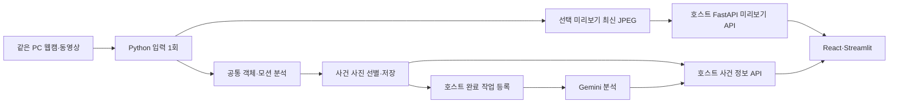

# motion_person 리팩토링 및 같은 PC 웹캠 연결안

2026년 10월 12일. 사용자가 제공한 후속 검토 보고서와 소스를 대조한 설계 기록이다. **웹캠과 FastAPI가 같은 PC에서 실행되는 설계로 구현했다.** 구현 결과는 [아키텍처 안내](architecture.md)와 [검증 보고서](refactoring_implementation_report.md)를 참고한다. 아래 재검토 표의 코드 위치와 227개 테스트는 구현 전 상태의 기록이다.

## 확정된 목표

- 모듈 책임: 웹캠 또는 동영상의 프레임 분석, 객체 움직임 판정, 사건 사진 묶음 생성, 완료 결과 전달.
- 호스트 프로젝트 책임: FastAPI, React 또는 Streamlit, Gemini 호출, 분석 결과 및 필요한 장기 이력 관리.
- 웹캠 위치: **FastAPI와 같은 PC에 연결된 웹캠**. Python이 직접 장치를 열고, 프론트는 FastAPI가 제공하는 미리보기를 표시한다.
- 초기 운영 범위: 카메라 1개와 이를 관리하는 FastAPI 프로세스 1개. 웹 화면을 여러 번 열어도 분석 실행과 모델을 복제하지 않는다.
- 후속 구현 요청에 따라 폴더 정리·중복 분석 통합·선택 진단·공유 미리보기와 연결 예제를 구현했다. 기존 미커밋 변경과 공개 import는 보존했다.

핵심 개선 방향은 폴더 이동과 함께 중복 분석 경로를 실제로 통합하고, 실행 이력을 선택화하며, **한 입력을 모션 분석과 프론트 미리보기에 공유하는 것**이다. 로컬 웹캠과 파일 입력의 공통 분석 경계를 정리한다.

## 제공된 보고서 재검토

큰 방향은 동의한다. FrameAnalysis, 독립 사진 선별, 저장 완료 결과 회수는 실제 개선이다. 구현 전 검토에서 전체 테스트 **227개 통과**를 확인했다. 그 이후 아래 오류 경로를 회귀 테스트로 고정하고 수정했다. 최신 검증 수치는 별도 검증 보고서에 기록한다.

현재 다시 확인한 핵심 항목은 다음과 같다.

| 항목 | 검증 및 판정 | 후속 조치 |
| --- | --- | --- |
| 캡처와 실행 이력의 강제 결합 | [engine.py:138](../motion_person/engine.py#L138)의 로그 쓰기가 완료 콜백보다 앞섬. 앞선 직접 재현에서 사진 저장 성공·콜백 0회 확인 | 진단 기본 off, 선택 진단의 실패와 완료 전달 분리 |
| 추적 ID 사전의 누적 | [object_detector.py:63](../motion_person/object_detector.py#L63)에 만료·상한 없음. 앞선 20,000개 ID 합성 측정 약 8.17 MiB | 제한된 추적 상태와 독립 증가 ID 카운터 |
| KeyboardInterrupt 때 완료 전달 누락 | 전체 MotionEngine에 다음 구간 인코딩 인터럽트를 주입. USER_INTERRUPT로 종료하고 자원을 닫지만, 저장된 사건 1개에 대해 콜백 0회 | 일반 오류와 인터럽트의 완료 회수 경로 통합 |
| max_images=2일 때 움직임 사진 없음 | 정상 입력으로 0초와 6.5초 사진만 선택됨. 움직임 객체 사진은 0장 | Gemini 입력 목적에 맞게 움직임 증거를 먼저 확보 |
| 사후 구간 누락인데 post_context_complete=True | 3.5초 뒤 바로 6.5초 프레임을 주입. gaps=1, overall complete=False, post complete=True | 구간별 품질 정보를 실제 관측과 일치시킴 |
| 시작 직후 사전 맥락을 완전하다고 표시 | 시작 후 0.5·1·2초에 움직임을 주입. 요청한 사전 3초가 없는데 pre complete=True | 요청 구간 부족과 실제 보관 구간을 구분 |

마지막 두 항목은 이번 Gemini 연결에서 중요하다. 분석 모델과 프론트가 완전하다고 표시된 구간을 실제로는 보지 못할 수 있기 때문이다.

보고서의 세 표현은 조정해야 한다.

1. 인터럽트 항목의 ‘유실’은 **사진 파일의 유실이 아니라 완료 전달 누락**이다. 저장 파일은 남는다. 호스트 작업 등록을 시작하지 못한다는 것이 실제 영향이다.
2. 두 장 설정은 기존의 ‘시간 양 끝 유지’ 계약대로 동작한다. 다만 Gemini에 움직임 증거를 전달한다는 새 목표에는 부적합하다. 정책 변경을 명시하고 관련 기존 테스트도 새 우선순위에 맞춰 바꿔야 한다.
3. 경량화가 YOLO extra 전환 하나로 끝나지는 않는다. 이 변경은 자체 탐지기를 주입하는 호스트의 설치 비용을 줄인다. YOLO를 실제 사용하는 실행은 여전히 PyTorch 비용을 가진다. 입력 버퍼·실행 수·추적 상태·미리보기 크기 제한도 필요하다.

## 같은 PC 웹캠을 연결하는 흐름



카메라를 여는 주체는 Python이다. 프론트에서 카메라를 다시 열지 않고, 실행 시작·중지와 화면 조회만 요청한다. 업로드 동영상은 호스트가 받은 파일을 모듈의 video 입력으로 전달한다.

현재 [webcam_source.py:14](../motion_person/webcam_source.py#L14)는 읽기 스레드가 최신 프레임 하나를 덮어쓰고 분석기가 선택한 프레임을 가져가는 구조다. 이를 활용하면 브라우저 업로드 수신기·네트워크 입력 시각 동기화·클라이언트 카메라 컴포넌트를 새로 만들 필요가 없다.

기존 read()는 분석용 프레임을 소비하는 메서드다. 미리보기에서 동시에 호출하면 서로 프레임을 가져갈 수 있으므로 **분석 소비와 조회를 구분하는 공개 프레임 공유 계약**이 필요하다. 비공개 `_latest`를 호스트가 직접 읽게 하지 않는다. 파일 입력의 미리보기도 분석 루프가 읽은 프레임을 공유하며, 화면 조회 때문에 파일을 추가로 읽지 않는다.

분석은 관측 가능한 입력을 처리하고, 미리보기는 설정한 표시 FPS만큼만 축소·JPEG 인코딩한다. 입력 FPS·분석 FPS·미리보기 FPS·사건 후보 수집 간격은 서로 다른 값이다. 미리보기를 낮춰도 사건 후보 수집 간격을 바꾸지 않는다.

표시용 인코딩은 선택 기능이며 분석 스레드에서 무거운 렌더링이나 클라이언트 송신을 기다리지 않는다. 최신 입력 또는 최신 분석 결과의 참조를 짧게 공개하고, 선택적 미리보기 작업이 제한된 빈도로 JPEG를 만든다. 같은 인코딩 결과를 모든 시청자가 공유하고, 느린 시청자는 오래된 표시 프레임을 건너뛴다.

카메라 입력의 최신 프레임, 처리 중인 프레임, 최신 표시 JPEG와 사건용 JPEG 버퍼의 수명·한도를 명시한다. 전 구간 영상이나 시청자별 프레임 이력을 보관하지 않는다. 미리보기를 사용하지 않으면 표시용 인코딩도 실행하지 않는다.

웹캠 시각은 현재처럼 Python이 입력을 받은 monotonic 경과 시각을 사용한다. 이는 센서의 정확한 촬영 시각을 보장하는 값은 아니다. 동영상은 원본 미디어 시간으로 사건을 계산한다. 표시 시각이나 Gemini 응답 시각을 사건 시간으로 대신하지 않는다.

Gemini용 사진은 원본 전체 프레임을 유지한다. 화면의 축소·좌우 반전·박스·글자는 표시용 프레임에만 적용한다. 미리보기 품질 설정은 증거 사진의 해상도와 품질 설정에서 분리한다.

## React와 Streamlit의 차이

| 영역 | React | Streamlit |
| --- | --- | --- |
| 카메라 실행 | FastAPI 시작·중지 API 호출 | 동일한 API 호출 |
| 실시간 미리보기 | MJPEG 이미지 스트림 표시 | 최신 JPEG 조회와 이미지 표시 |
| 분석 | 같은 Python 실행을 공유 | 같은 Python 실행을 공유 |
| 사건 목록·Gemini 상태 | 상태 조회 또는 호스트 이벤트 알림 | 상태 조회, 필요한 부분만 주기 갱신 |
| 업로드 동영상 보기 | 브라우저 영상 플레이어와 사건 타임라인 | 영상 플레이어와 사건 카드 |

React의 초기 미리보기는 `` 형태의 MJPEG를 권장한다. FastAPI의 스트리밍 응답과 multipart 이미지 표시를 활용한다. 별도 프론트 영상 디코더를 만드는 작업 없이 구현할 수 있다. 이는 초기 구현 선택이며 오디오나 다자간 통화 기능을 포함하지 않는다. [FastAPI StreamingResponse](https://fastapi.tiangolo.com/advanced/custom-response/#streamingresponse), [HTML multipart 이미지 처리](https://html.spec.whatwg.org/multipage/images.html#multipart/x-mixed-replace).

Streamlit은 최신 JPEG를 st.image로 보여주고 fragment의 run_every로 필요한 영역만 갱신한다. 매번 같은 FastAPI 실행을 조회한다. 앱 재실행마다 카메라나 모델을 생성하지 않는다. 이 구성에는 st.camera_input이나 브라우저 카메라 업로더가 필요 없다. [Streamlit image](https://docs.streamlit.io/develop/api-reference/media/st.image), [Streamlit fragment](https://docs.streamlit.io/develop/api-reference/execution-flow/st.fragment).

업로드 동영상은 호스트가 파일을 받아 기존 video 입력으로 분석한다. 프론트 재생 위치는 원본 영상 시간과 연결한다. 빠른 분석의 진행 화면과 사용자가 영상 플레이어에서 재생하는 시점은 다른 값이다. 탐색·되감기는 기존 모션 상태를 임의로 되돌리지 않고, 필요할 때 새 분석 세션을 시작한다.

감지 박스를 표시할 경우 해당 결과와 같은 frame_index의 프레임에 그린다. 최신 입력에 이전 분석의 박스를 그대로 겹치지 않는다. 원본 전체 좌표·분석 ROI·미리보기 축소·좌우 반전의 변환도 일치시킨다. 초기에는 원본 미리보기와 사건 사진을 우선 제공하고, 박스 표시를 선택 기능으로 둔다.

## FastAPI의 실행 소유권과 작은 연결 계약

FastAPI 호스트가 카메라 실행을 소유한다. 프론트의 시작 버튼이 하나의 실행을 시작하고, 미리보기 접속은 이미 존재하는 실행만 조회한다. 같은 카메라의 중복 시작은 기존 run_id를 반환하거나 실행 중임을 명시한다. 새 카메라·모델을 만들지 않는다.

현재 MotionEngine.start()는 종료까지 블로킹하므로 HTTP 요청의 실행 스레드나 이벤트 루프에서 직접 계속 기다리지 않는다. 호스트가 관리하는 작업 스레드에서 실행하고, 시작 요청에는 run_id와 준비 상태를 반환한다. 준비·배경 학습·동작·종료 중·종료·오류 상태를 프론트에서 구분한다.

FastAPI lifespan에서 호스트 실행 관리자의 수명을 정하고 종료 시 stop과 자원 정리를 기다린다. 카메라의 실제 개방은 사용자의 시작 요청에 맞춘다. 초기 모델 준비는 실행 시작 경계에서 한 번 수행한다. [FastAPI lifespan](https://fastapi.tiangolo.com/advanced/events/).

같은 PC의 초기 운영은 **FastAPI worker 1개**로 정한다. 프로세스별 상태가 독립적인 다중 worker에서 각자 같은 카메라를 열거나 모델을 복제하는 구성을 만들지 않는다. 시청자 수가 늘어나는 것과 카메라 분석 실행 수가 늘어나는 것은 다른 문제다. [FastAPI 프로세스·메모리](https://fastapi.tiangolo.com/deployment/concepts/#memory).

호스트 API는 다음 정도면 충분하다. 경로와 필드는 제안이며 현재 구현에 존재하지 않는다.

| API | 목적 |
| --- | --- |
| POST /motion/runs | 웹캠 또는 동영상 분석 시작 |
| POST /motion/runs/{run_id}/stop | 실행 중지 요청 |
| GET /motion/runs/{run_id} | 준비·분석·오류·활성 사건 상태 조회 |
| GET /motion/runs/{run_id}/preview.mjpg | React 미리보기 스트림 |
| GET /motion/runs/{run_id}/preview.jpg | Streamlit 또는 단일 화면 조회 |
| GET /motion/runs/{run_id}/events | 호스트의 사건·Gemini 작업 상태 조회 |
| GET /motion/events/{event_id}/parts/{part_index}/images/{image_id} | 선택한 사건 사진 조회 |

동영상 업로드는 호스트의 파일 입력 기능으로 처리한다. 카메라 프레임 업로드 API는 이번 범위에 없다. 사진 URL과 분석 상태는 호스트가 제공한다.

미리보기 접속 종료는 해당 시청자의 구독만 종료한다. 분석은 명시적인 stop 또는 앱 종료까지 유지한다. stop은 종료 중 상태를 먼저 반환하고, 실행이 자원을 정리한 뒤 종료로 바뀐다. 미리보기 인코딩·송신 실패는 분석 완료 전달을 막지 않도록 처리한다.

MJPEG·JPEG 응답은 현재 화면임을 알 수 있도록 run_id·프레임 번호·경과 시각을 연결하고 오래된 화면을 캐시하지 않는다. 입력이 끊겼을 때 마지막 JPEG를 현재 생방송처럼 계속 표시하지 않고 입력 오류 상태를 함께 보여준다.

## 목표 폴더와 의존성 경계

다음은 구현할 구조의 제안이며 아직 생성하지 않았다. HTTP와 DB용 폴더를 영상 모듈 내부에 억지로 만들지 않는다.

```text
motion_person/
  __init__.py                   기존 공개 API
  domain/
    contracts.py                프레임·객체·오류 계약
    settings.py                 설정 값과 값 검증
    events.py                   사건·사진 데이터와 구간 정의
    motion_rules.py             움직임 조건
    photo_selection.py          사진 선택·제거 정책
  application/
    engine.py                   공통 실행과 종료 흐름
    processor.py                공통 프레임 분석 순서
    event_capture.py            사건 상태와 제한된 후보 버퍼
    ports.py                    필요한 입력·탐지·저장 계약
  adapters/
    yolo.py                     모델·추적 구현
    motion.py                   MOG2 구현
    frames.py                   영상 배열 준비
    video.py                    파일 입력
    webcam.py                   Python 실행 장치의 로컬 입력
    preview_encoder.py          선택 표시 JPEG 인코딩
    bundle_store.py             사진·manifest 공개
    diagnostics.py              선택 실행 이력
  presentation/
    cli.py                      명령행 조립
    overlay.py                  선택 화면 렌더링
    preview.py                  선택 미리보기 조립
    legacy/                     기존 개별 캡처 계약
examples/
  fastapi/                      호스트 연결 예시
  react/                        선택 프론트 연결 예시
  streamlit/                    선택 프론트 연결 예시
tests/
docs/
```

domain은 UI와 파일 쓰기, YOLO 구현을 import하지 않는다. application은 필요한 작은 Protocol과 함수에 의존한다. 실제 구현의 생성은 공개 API와 CLI의 조립 경계에서 한다. FastAPI·Gemini SDK·React·Streamlit은 모듈의 domain/application에 들어오지 않는다.

단순 파일 이동으로 끝내지 않는다.

- 기존 main의 분석 순서를 FrameProcessor로 통합한다. 필요한 기존 성능 지표는 선택 측정 경로로 보존한다.
- 미리보기 진입점도 공통 실행과 자원 정리를 사용한다. 공통 프레임 공유 경계를 사용하고, 분석용 프레임은 원본 방향을 유지한다.
- 사진 선별이 사용하는 활성 구간과 저장 결과의 누락 계산이 같은 정의를 사용하도록 한다.
- 사건 상태 관리와 디스크 공개만 실제 경계로 나눈다. 정책마다 새 클래스나 이벤트 버스를 만드는 작업은 하지 않는다.
- Config의 argparse·파일 존재 확인·쓰기 검사와 값 검증을 분리한다.
- 기존 공개 MotionEngine·EventBundle 이름과 생성 계약을 보호한다. 기존 진입점은 위임 파일로 남기고 실제 로직은 한 곳에 둔다.

ports도 소비자가 필요한 동작만 선언한다. 자체 탐지기가 detect만 제공하는 경우 YOLO 전용 준비 메서드를 강제로 구현하게 하지 않고, 초기화는 조립 단계에서 처리한다.

## 사건 묶음을 Gemini와 프론트가 이해하는 방법

사건은 객체 모션 수집 구간이다. 사용자 행동 의미의 시작·종료나 실제 사람의 신원 판정과 동일하지 않다.

- event_id는 한 모션 에피소드, part_index는 길이 제한으로 나눈 사진 묶음이다.
- MAX_DURATION과 episode_end=False는 계속될 수 있는 사건의 한 부분이다. 프론트에서는 같은 사건 아래 부분들을 표시한다.
- 현재 RunSummary.event_count는 완료 묶음 수다. 사건 수와 묶음 수의 명칭을 분리하고, 기존 필드는 호환 목적을 명시한다.
- 사진은 시간순으로 전달하고 phase·roles·움직임 객체 정보를 함께 제공한다.
- 움직임 증거를 먼저 확보하고, 남는 예산으로 사전·사후 맥락을 채운다. 특히 두 장 설정에서도 움직임 증거가 없는 묶음을 정상 선택 결과로 만들지 않는다.
- 요청한 사전/사후 구간, 관측 누락과 실제 선택된 사진의 구간 포함 여부는 구분한다. context_complete 하나를 ‘모든 증거가 완벽함’으로 표현하지 않는다.
- track_id는 실행 내 추적 키다. ID 변경만으로 같은 물리 객체 여부를 확정하거나 무거운 재식별 기능을 추가하지 않는다.

필요한 출력 계약은 다음 범위다. 현재 필드와 추가할 필드를 호환 가능한 방식으로 구분해 구현한다.

| 범위 | 전달할 정보 |
| --- | --- |
| 출처 | run_id, source_id, 웹캠/동영상 종류, 시간 기준 |
| 구간 | event_id, part_index, 시작·트리거·마지막 움직임·종료 시각 |
| 종료 | end_reason, episode_end |
| 사진 | 식별자, 촬영 시각, phase·roles, 객체·좌표·움직임 근거 |
| 품질 | 사전/사후 맥락 부족, 관측 간격 누락, 메모리 제거, 객체 증거 누락 |

모듈 내부의 Path는 저장 결과다. 프론트에서는 호스트가 제공한 사진 URL과 공개 식별자를 사용하도록 변환한다. 서버의 절대 파일 경로를 브라우저 표시 계약으로 사용하지 않는다.

모듈은 완성된 사진과 메타데이터를 on_event로 전달한다. 호스트가 짧게 Gemini 작업을 등록한다. 네트워크 분석을 기다리는 동안 프레임 분석을 정지시키지 않는다. Gemini는 여러 이미지를 한 요청에 포함할 수 있으므로, 시간순 사진과 구간 설명을 묶어 보내는 방식이 이 목적에 맞는다. [Gemini image understanding](https://ai.google.dev/gemini-api/docs/image-understanding).

queued·analyzing·done·failed 같은 Gemini 작업 상태는 호스트가 소유한다. 모듈의 capturing·ready 상태와 섞지 않는다. 호스트의 작업 등록은 run_id/event_id/part_index로 중복을 구분하며, 큐가 가득 차거나 등록이 실패했을 때 저장된 manifest를 복구 근거로 남긴다. 프로세스 내부 콜백 1회와 외부 분석 작업의 정확히 1회 보장은 다른 계약이다.

## 경량화 정책

- 라이브러리 기본값: 네이티브 창 off, 실행 이력 off. 필요한 경우 명시적으로 켠다.
- 사진과 최소 event.json은 핵심 산출물로 유지한다.
- 원본 전체 동영상, 모든 프레임, 모든 과거 객체 상태를 모듈 내부에 쌓지 않는다.
- 최신 입력·최근 분석 화면·표시 JPEG는 제한된 크기만 보관한다. JPEG 사건 버퍼와 별개로 입력 해상도·미리보기 크기·추적 상태도 제한한다.
- 모델을 프레임이나 프론트 재실행마다 생성하지 않는다. 카메라 하나의 실행과 모델을 모든 시청자가 공유한다. 서로 다른 카메라의 persist 추적 상태를 무조건 공유하지 않는다.
- NumPy·OpenCV는 현재 분석 핵심이다. YOLO와 lap은 선택 설치로 나눌 수 있지만 YOLO 사용 시 torch 비용은 남는다. OpenCV의 GUI/headless 배포판을 동시에 설치하는 형태를 만들지 않는다.
- FastAPI·프론트·Gemini 의존성은 호스트 또는 examples의 설치 범위로 둔다.

자체 코드 약 243 KiB와 앞선 실제 영상 처리 최대 RSS 약 411 MiB는 서로 다른 수치다. 폴더 정리의 목적은 유지보수이며, 모델 의존성의 실행 메모리가 사라지는 효과를 주장하지 않는다.

## 구현 순서와 완료 기준

1. **핵심 오류와 사진 품질 먼저 고정.** 로그 실패, 인터럽트 완료 전달, 두 장 사진 선별, 사전/사후 품질에 의미 있는 회귀 테스트를 추가한다. 기본 설정의 핵심 사진 동작은 보존한다.
2. **중복 분석과 설정 분리.** 공통 FrameProcessor, 작은 주입 계약, 선택 진단을 연결한다. 기존 CLI와 API의 호환 테스트를 실행한다.
3. **폴더 이동과 저장 경계 분리.** 공개 import와 명령행 진입점을 유지하며 canonical 구현을 역할별 패키지로 이동한다. 핵심 계층에서 UI·YOLO·파일 쓰기로 역의존하지 않는지 검사한다.
4. **상한 있는 추적과 미리보기 공유.** 긴 합성 스트림으로 상태 수가 제한되는지, 가림 복구·확인 횟수·ID 재사용 방지가 유지되는지 확인한다. 화면 조회 때문에 분석 프레임을 소비하지 않는지, 표시 버퍼가 늘지 않는지 검증한다.
5. **FastAPI와 프론트 연결 예시.** 실제 프로젝트 코드가 이 폴더에 없으므로 별도 examples로 검증한다. 같은 PC 웹캠과 영상 파일 입력, 사건과 사진 조회가 같은 모듈을 사용하는지 확인한다. React·Streamlit 중 어느 쪽을 써도 서버에서 중복 분석하지 않는다.
6. **문서와 패키징 검증.** 기본/YOLO 선택 설치, wheel 포함 범위, 기존 사용법, 프레임 공유와 사건 품질 계약을 문서화한다. 실행 이력 off 상태에서도 사진·manifest·콜백이 동작하는 것을 확인한다.

추가 완료 기준은 다음과 같다.

- 프론트 두 곳에서 같은 미리보기를 조회해도 카메라 개방과 모델 준비는 한 번이며, 처리 프레임당 추론도 한 번이다.
- 느린 시청자·접속 종료·표시 실패가 사건 캡처와 완료 콜백을 막지 않는다.
- 미리보기 off 상태에서는 표시용 렌더링과 JPEG 인코딩을 실행하지 않는다.
- stop·입력 오류·인터럽트·앱 종료에서 저장된 완료 묶음을 회수하고 카메라·작업을 정리한다. 정리 실패는 기존 오류를 보존하며 추가 정보로 남긴다.
- Streamlit 재실행이 새 분석 실행을 만들지 않는다.
- 10초 분할과 두 장/여섯 장 선택, 시간순 사진, 부족한 맥락 표시를 프론트·Gemini 입력 양쪽에서 검증한다.

실제 웹캠의 장치 권한·드라이버 종료, 미리보기 성능과 여러 시청자의 부하는 합성 입력 테스트와 구분해서 확인해야 한다. 현재 227개 테스트와 짧은 예제 영상 결과만으로 해당 성능을 보장하지 않는다.

## 이번 단계에서 수행한 것

- 제공 보고서와 현재 소스를 대조.
- 전체 테스트 227개 재확인.
- 전체 엔진의 인터럽트 완료 전달 누락 재현.
- 두 장 사진 설정의 움직임 증거 누락 재현.
- 사전/사후 구간 품질 표시의 부정확성 재현.
- 최초 브라우저 웹캠 연결안을 작성한 뒤, 사용자 선택에 따라 **같은 PC 웹캠을 Python이 직접 읽는 연결안으로 갱신**.
- React·Streamlit의 조회 방식과 카메라·모델 실행 소유권, 미리보기 버퍼와 수명 정책을 재검토.
- 후속 구현: 역할별 폴더 이동, 공통 FrameProcessor, 주입 가능한 탐지/저장 경계, 진단 기본 off.
- 완료 전달·두 장 사진 선택·사전/사후 품질 표시 보완, 추적 상태 만료와 상한 추가.
- 최신 프레임/JPEG 공유 미리보기와 FastAPI·React·Streamlit 연결 예제 구현.
- 실제 동영상의 사건/묶음·사진 URL을 양쪽 프론트에서 확인. 종료 상태 갱신 오류도 재현 후 수정.
